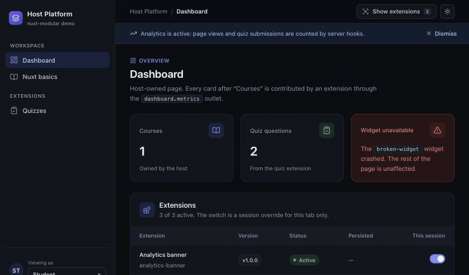

<h1 align="center">nuxt-modular</h1>

<p align="center"><strong>A plugin and extension system for Nuxt.</strong> Build modular, extensible Nuxt apps with outlets, permissions,
feature toggles, hooks, and database migrations (SQLite, PostgreSQL, MySQL).</p>

<p align="center">
  <a href="https://www.npmjs.com/package/nuxt-modular"></a>
  <a href="https://github.com/githubthinnd/nuxt-modular/actions/workflows/ci.yml"></a>
  <a href="./LICENSE"></a>
  
</p>

<p align="center">
  
</p>

<p align="center"><sub>The playground: press <kbd>X</kbd> to outline what each extension contributes, switch roles to change navigation and slots,
take the quiz (a server filter hook adds a bonus configured in the manifest), then switch an extension off and watch its UI disappear.</sub></p>

| Path | Package | Purpose |
|------|---------|---------|
| `packages/core` | `@nuxt-modular/core` | Framework-agnostic manifest schemas, registry, permissions, hook bus, migrations, seeders, semver, scanner |
| `packages/nuxt` | `nuxt-modular` | The Nuxt module, runtime composables, `<PluginOutlet>`, Nitro integration and tasks |
| `packages/cli` | `@nuxt-modular/cli` | `nuxt-modular make:*`, `list`, `validate` |
| `playground` | — | Host app with `quiz`, `analytics-banner` and `broken-widget` extensions |

**User guide: [guide/](./guide/README.md)** · Module overview: [packages/nuxt/README.md](./packages/nuxt/README.md) ·
CLI: [packages/cli/README.md](./packages/cli/README.md) · [CHANGELOG](./CHANGELOG.md) ·
[CONTRIBUTING](./CONTRIBUTING.md) · [SECURITY](./SECURITY.md).

## Development

```bash
pnpm install
pnpm dev          # playground on http://localhost:3000
pnpm check        # typecheck + unit tests + builds + SSR verification
```

| Script | What it does |
|--------|--------------|
| `pnpm build` | Builds `@nuxt-modular/core`, then `nuxt-modular` and `@nuxt-modular/cli` |
| `pnpm typecheck` | `tsc` for core, `vue-tsc` for the module and the playground |
| `pnpm test` | Vitest: manifest/registry/hook bus (core), CLI generators, scanner and SSR→hydration boundary tests (nuxt) |
| `pnpm verify:ssr` | `nuxi generate` the playground three times (all extensions, build-time removal, persistent toggle) and assert on HTML, payloads, routes and bundles (`scripts/check-ssr.mjs`) |
| `pnpm test:e2e` | Playwright against a production build: hydration warnings, roles, toggles, quiz flow, migrations (`playground/e2e`). Run `pnpm --dir playground exec playwright install chromium` once |
| `pnpm verify:sandbox` | Same checks for environments where `pnpm install` or local ports are blocked (`scripts/sandbox-verify.mjs`) |

In the playground, switch the role in the sidebar to see permission-gated slots
and navigation, toggle extensions for your tab on the dashboard, persist toggles
for everyone as `admin`, and remove extensions at build time with
`NUXT_MODULAR_DISABLED=analytics-banner,broken-widget pnpm dev`. Playground data
(toggles, migration ledger) lives in `playground/.data`.

CI (`.github/workflows/ci.yml`) runs `pnpm check` and the E2E suite; it needs a
committed, complete `pnpm-lock.yaml`.

## License

[MIT](./LICENSE)
